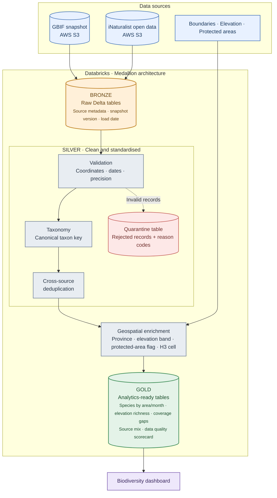

# PH Biodiversity Explorer

A data pipeline that combines species observation records from GBIF and iNaturalist into a clean, quality-checked, analysis-ready view of biodiversity in the Philippines, and shows where the data is thin.

> **Status:** in progress. Currently setting up the project and building the bronze layer. See the [Roadmap](#roadmap).

## Problem

Public biodiversity data is large, messy, and spread across sources:

- Billions of records worldwide, so loading only what you need is a challenge in itself.
- The same sighting can appear in more than one source.
- Coordinates, dates, and species names are often missing, imprecise, or inconsistent.
- A map of records is easily mistaken for a map of biodiversity, when it mostly reflects where people look.

Researchers and students often spend more time cleaning this data than analysing it. This project does the cleaning and combining once, documents every decision, and publishes the result.

## Who it's for

- Students and researchers in ecology and environmental science
- Conservation groups and protected-area managers looking for survey gaps
- Educators, hikers, and nature enthusiasts exploring what has been recorded where
- Other developers who want a clean base table for further analysis

## Questions it will answer

- Which areas and elevation bands are well surveyed, and which are blind spots?
- How does the number of recorded species change with elevation?
- How has the mix of sources (citizen science vs. museum specimens) changed over time?
- Where does observer bias show up, such as clustering near cities, roads, and trails?

## Data sources

| Source | What it provides | Access | Licence and citation notes |
|---|---|---|---|
| GBIF | Species occurrence records | Monthly Parquet snapshots on AWS S3 (bulk) | Licence varies by dataset. Cite the snapshot used. *(fill in)* |
| iNaturalist open data | Observation, observer, photo, and taxa metadata | Open data files on S3 (bulk, monthly) | Licences vary per observation and photo, so licence fields are kept. *(fill in)* |
| Protected areas (WDPA) | Protected area boundaries and status | Download or API (token required) | Terms apply and a citation is required. *(fill in)* |
| Elevation | Digital elevation model (SRTM or Copernicus) | File download | *(fill in)* |
| Administrative boundaries | Provinces and municipalities | File download | *(fill in)* |

**Design choice:** the main sources are loaded from bulk files instead of APIs. This is faster and more reliable for large volumes, avoids rate limits, and makes each load reproducible by snapshot version. See [docs/decisions.md](docs/decisions.md).

## Architecture

**Stack:** Databricks, PySpark, Delta Lake, SQL, AWS S3.

## Pipeline layers

**Bronze (raw)**
- Philippine records from GBIF and the full iNaturalist metadata, stored as received.
- Each row carries its source, snapshot version, and load date.

**Silver (clean)**
- Validated coordinates and dates, with a precision column for partial dates.
- Taxonomy standardised to a single canonical taxon key.
- Cross-source duplicates merged.
- Invalid records sent to a quarantine table instead of being silently dropped.
- Enriched with province, elevation band, protected-area flag, and an H3 grid cell.

**Gold (analytics)**
- Species by area and month
- Richness by elevation band
- Coverage gaps
- Source mix by year
- Data quality scorecard

## Data quality approach

- Row counts reconciled between layers.
- Null-rate and range checks on key columns.
- Quarantine table with a reason code for every rejected record.
- A before/after quality report published with each load.
- Threatened species with intentionally generalised coordinates are flagged and handled separately, not treated as errors.

## Known limitations

- The data shows **recorded sightings**, not a complete species list.
- Observation effort is uneven, so well-visited places look richer than remote ones.
- Coordinate precision varies and some records cannot be used spatially.
- Deduplication across sources is heuristic and may miss or over-merge some records.
- Only the scope in the roadmap is covered. Other taxa and regions are future work.

## Roadmap

- [x] Milestone 0: repo, cloud setup, scope
- [ ] Milestone 1: bronze layer (GBIF and iNaturalist loaded to Delta)
- [ ] Milestone 2: silver cleaning, taxonomy, deduplication, quarantine
- [ ] Milestone 3: geographic and elevation enrichment
- [ ] Milestone 4: gold tables
- [ ] Milestone 5: dashboard
- [ ] Milestone 6: scheduled workflow and incremental loads
- [ ] Milestone 7: documentation and demo

## Decisions and lessons

- [docs/decisions.md](docs/decisions.md): why each design choice was made
- [docs/problems-log.md](docs/problems-log.md): problems hit along the way and how they were solved

## Acknowledgements

Data from GBIF, iNaturalist and its contributors, and the other sources listed above. Please follow each source's licence and citation requirements when reusing results.

Code licence: MIT

**Author:** Gladwyn Sencil, sencilgladwyn@gmail.com, [LinkedIn](https://www.linkedin.com/in/gladwyn-sencil-18b957278/)
